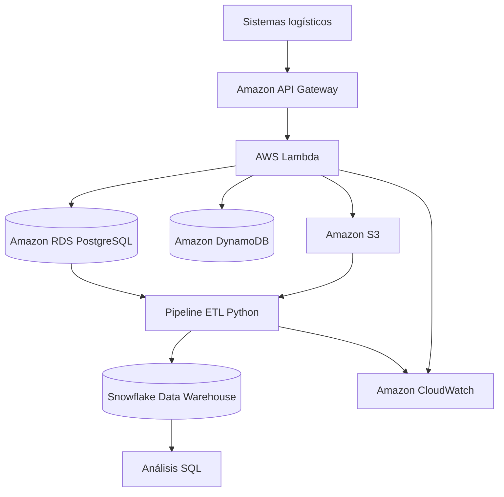

# FleetLogix M2 — Avance 4
## Arquitectura propuesta en AWS

### 1. Objetivo

Diseñar una arquitectura cloud escalable, segura y
mantenible para procesar información logística.

Esta arquitectura es una propuesta de despliegue.
No se afirma que los servicios AWS estén implementados.

### 2. Diagrama de arquitectura

### 3. Servicios AWS

- **API Gateway:** recibe solicitudes HTTPS.
- **Lambda:** procesa eventos logísticos.
- **RDS PostgreSQL:** almacena datos operacionales.
- **DynamoDB:** permite consultar estados de seguimiento.
- **S3:** almacena archivos y exportaciones.
- **CloudWatch:** registra eventos, errores y métricas.
- **Snowflake:** almacena el modelo analítico.

### 4. Justificación técnica

Se propone una arquitectura que separa las operaciones
logísticas del análisis de datos.

RDS permite trabajar con relaciones y transacciones.
DynamoDB facilita consultas rápidas por identificador.
Lambda permite procesar eventos sin administrar servidores.
S3 proporciona almacenamiento de objetos.
Snowflake permite analizar grandes volúmenes de información.

### 5. Seguridad y escalabilidad

- HTTPS para las comunicaciones.
- IAM con permisos mínimos.
- Cifrado de información.
- RDS en una red privada.
- Administración segura de credenciales.
- Monitoreo mediante CloudWatch.
- Escalabilidad de servicios administrados.

### 6. Costos mensuales estimados

Escenario académico pequeño, región us-east-1.

| Servicio | USD/mes estimado |
|---|---:|
| API Gateway | 1-5 |
| Lambda | 0-5 |
| RDS PostgreSQL | 15-40 |
| DynamoDB | 1-5 |
| S3 | 1-3 |
| CloudWatch | 0-5 |
| Total orientativo | 18-68 |

Estos importes son supuestos de planificación,
no precios cotizados ni verificados.

No incluyen Snowflake, transferencia de datos,
impuestos, NAT Gateway ni alta disponibilidad.

### 7. Estado del proyecto

Implementado:
- PostgreSQL.
- Python ETL.
- Snowflake.
- Modelo estrella.
- Controles automáticos de calidad.

Propuesto:
- API Gateway.
- Lambda.
- RDS administrado.
- DynamoDB.
- S3.
- CloudWatch.

### 8. Conclusión

La arquitectura propuesta permite evolucionar
FleetLogix hacia un entorno cloud escalable,
seguro y preparado para análisis de datos.
