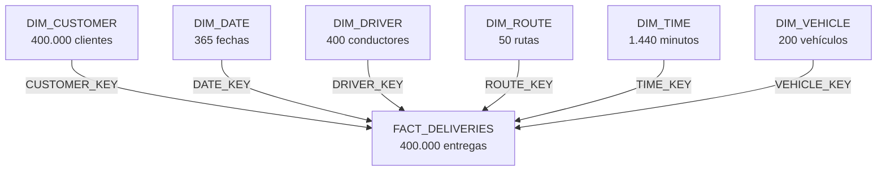

# FleetLogix M2 — Modelo estrella

## Diagrama dimensional

## Granularidad

Una fila de FACT_DELIVERIES representa una entrega.

## Relaciones

La tabla de hechos se relaciona con seis dimensiones
mediante claves dimensionales.

## Consideraciones

La distancia y el combustible corresponden al viaje.
Si un viaje contiene varias entregas, estos valores
pueden repetirse en la tabla de hechos.

Por eso no deben sumarse directamente por entrega.

## Plataforma

- Data Warehouse: Snowflake
- Base de datos: FLEETLOGIX_DW
- Esquema: ANALYTICS
- Warehouse: FLEETLOGIX_WH
